# Travel Rule cho luồng rút tiền: 4 nhà cung cấp, Fireblocks và Binance

Nov 6, 2026 · @Mincuk

## Tổng quan

Khi khách rút tiền ra sàn khác, sàn của bạn là **sàn gửi** và phải trao đổi xong dữ liệu người gửi, người nhận với sàn đích **trước khi** broadcast giao dịch. Tài liệu này gồm ba phần:

1. Tích hợp trực tiếp với từng nhà cung cấp: Notabene, Sumsub, GTR, TRUST.
2. Tích hợp qua Fireblocks, nếu sàn đang dùng Fireblocks để ký và gửi giao dịch.
3. Cách Binance đang triển khai Travel Rule, và ảnh hưởng tới lệnh rút sang Binance.

Cuối tài liệu có thêm ba phần tham khảo: dữ liệu IVMS101 (so sánh bản 2020 và 2023), phạm vi của cầu nối Sumsub sang GTR, và khuyến nghị nếu chỉ chọn một nhà cung cấp.

Mọi luồng được mô tả bằng sơ đồ sequence. Tên API và trường dữ liệu lấy từ tài liệu công khai của từng bên; cần đối chiếu lại trước khi code.

### Bốn nhà cung cấp

| Nhà cung cấp | Bản chất | Mạng lưới | Giá |
| --- | --- | --- | --- |
| Notabene | Vendor SaaS, đa protocol | \~2.000+ VASP, 100+ khu vực pháp lý | Gói miễn phí Sunrise (gửi tới 10.000 USD/tháng, nhận không giới hạn); trả phí theo khối lượng gửi đi |
| Sumsub | Vendor SaaS (KYC + KYT + Travel Rule) | \~2.100+ VASP; cầu nối tới GTR, CODE, Sygna, TRP | Theo khối lượng, báo giá riêng; có gói Self-Service |
| GTR | Protocol do Binance dẫn dắt | Mọi pháp nhân Binance, OKX, Bybit, Bitget, Gate, HashKey, Circle… | Trial 60 ngày, 100 request/ngày; gói Pro theo năm, báo giá riêng |
| TRUST | Mạng đóng do Coinbase vận hành | \~195–200+ VASP: Coinbase, Kraken, Gemini, Crypto.com, Robinhood… | Chia chi phí giữa thành viên; miễn phí cho VASP nhỏ đủ điều kiện |

### Chọn kênh theo sàn đích

Không có mạng nào tới được mọi sàn. Sàn nên có một bộ định tuyến chọn kênh cho từng lệnh rút theo sàn đích:

| Sàn đích | Kênh ưu tiên | Dự phòng |
| --- | --- | --- |
| Binance, OKX, Bybit, Bitget, Gate, HashKey | GTR | Sumsub (cầu nối GTR), Notabene |
| Coinbase, Kraken, Gemini, Crypto.com | TRUST (nếu sàn bạn là thành viên) | TRUSThub, cổng chính |
| Các sàn còn lại | Cổng chính: Notabene hoặc Sumsub | Email (Sumsub, GTR Out-of-Network) |
| Không xác định được sàn | Xử lý như ví cá nhân | Compliance duyệt tay |

Nếu đi qua Fireblocks, lựa chọn bị ràng buộc thêm: một workspace chỉ chạy được Notabene **hoặc** cặp Sumsub + GTR, không trộn được Notabene với hai bên kia. TRUST dùng kèm được với bên nào cũng được.

## Luồng rút chung

Mọi kênh đều theo cùng một khung: **ghi lệnh rút → gửi dữ liệu qua kênh → chờ kết quả → ký và broadcast → báo txHash**. Các phần sau chỉ triển khai chi tiết bước "gửi dữ liệu" và "kết quả" cho từng kênh.

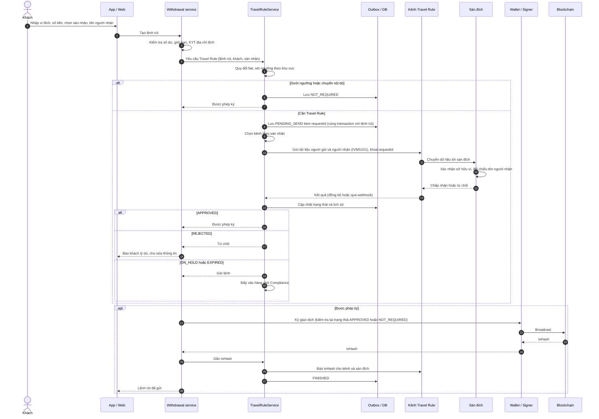

| Trạng thái lệnh rút | Ý nghĩa | Được ký? |
| --- | --- | --- |
| `NOT_REQUIRED` | Dưới ngưỡng hoặc nội bộ; vẫn lưu vết | Có |
| `PENDING_SEND` / `AWAITING_COUNTERPARTY` | Đã ghi, đang gửi hoặc chờ sàn đích | Không |
| `APPROVED` | Sàn đích chấp nhận hoặc rules cho đi | Có |
| `REJECTED` | Ví không thuộc sàn đích, tên lệch, hoặc bị từ chối | Không |
| `ON_HOLD` / `EXPIRED` | Chờ compliance, chứng minh ví, hoặc sàn đích không trả lời | Chỉ khi compliance duyệt |
| `FINISHED` / `CANCELLED` | Đã báo txHash, hoặc khách huỷ và đã báo huỷ | — |

Kiểm tra "được ký" phải nằm ở tầng ký giao dịch, không chỉ ở UI, để không đường nào bỏ qua được Travel Rule. Khi đi qua Fireblocks, khoá này do policy của Fireblocks đảm nhận.

## Rút qua Notabene

Sàn gọi `tx/create` một lần; Notabene tự tìm sàn đích, chọn protocol (hoặc TR:Now cho sàn chưa tích hợp) và báo kết quả qua một loại webhook. Chỉ broadcast khi trạng thái là `ACCEPTED`, hoặc `SAVED` khi không cần Travel Rule.

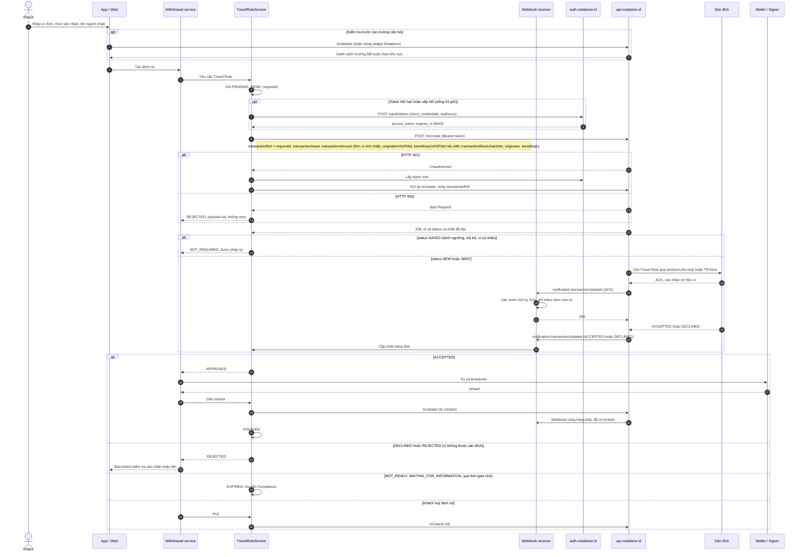

**Điểm cần lưu ý**

- Token: `POST https://auth.notabene.id/oauth/token`, `audience` = `https://api.notabene.dev` (sandbox) hoặc `https://api.notabene.id` (production). Token sống 24 giờ.
- `transactionRef` là khoá chống trùng. Bỏ `beneficiaryVASPdid` thì Notabene tự dò; địa chỉ có nhiều chủ sẽ không dò được, nên cho khách chọn sàn nhận.
- Webhook gửi qua Svix từ IP EU, mỗi lần gửi toàn bộ bản ghi.
- Notabene không nối trực tiếp vào TRUST.
- Ngoài `tx/create`, tên các API còn lại cần đối chiếu trong API reference của Notabene.

## Rút qua Sumsub

Lệnh rút là một giao dịch KYT `type: travelRule`, `direction: out`, gửi **trước khi** có txHash. Sumsub chọn protocol chung với sàn đích, hoặc gửi email nếu không có. Quyết định ký dựa vào **kết quả duyệt** (webhook `Approved` / `Rejected` / `OnHold`).

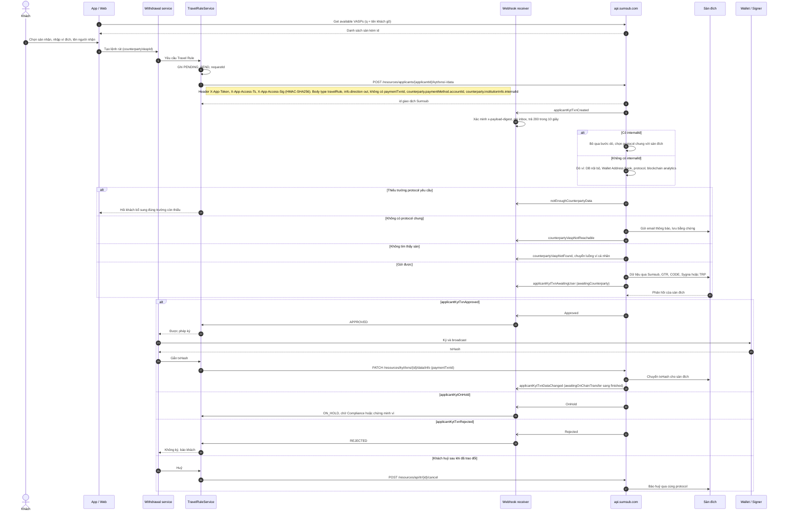

**Điểm cần lưu ý**

- Cho khách chọn sàn nhận và truyền `internalId` là yếu tố lớn nhất quyết định tỷ lệ thành công, theo chính Sumsub.
- Chữ ký request: timestamp lệch dưới 1 phút. Sandbox và production cùng host, phân biệt bằng token `sbx:` / `prod:`.
- Bước `PATCH ... paymentTxnId` là con đường duy nhất đưa giao dịch về `finished`, và cũng là bước hay bị bỏ sót nhất.
- Webhook trả 401/403/404 thì Sumsub không gửi lại.
- Có thể thay phần thu thập dữ liệu bằng Travel Rule SDK của Sumsub.
- Cần Sumsub xác nhận cầu nối sang GTR là giao dữ liệu đầy đủ hay chỉ xác thực, trước khi dựa vào Sumsub cho lệnh rút tới Binance.

## Rút qua GTR

GTR là kênh trực tiếp tới Binance và các thành viên GTR. Toàn bộ xác minh chạy **đồng bộ** trong một lời gọi `one_step` (tối đa 30 giây): GTR hỏi sàn đích địa chỉ có thuộc họ không, đúng thì mới chuyển PII. Sàn phải tự chỉ định sàn đích (`targetVaspCode`) và tự mã hoá PII bằng Curve25519.

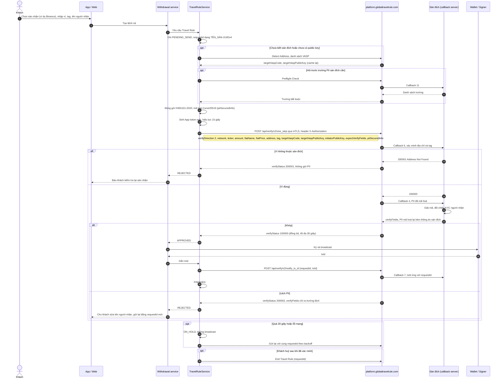

**Điểm cần lưu ý**

- Môi trường: UAT `uat-platform.globaltravelrule.com`, production `platform.globaltravelrule.com`. Mọi request đi qua mTLS (`certificate.p12`); khoá UAT không dùng được ở production.
- `one_step` luôn trả HTTP 200; kết quả nằm ở `verifyStatus`: `100000` thành công, `200001` sai ví, `200003` lệch PII.
- Bắt buộc gọi `notify_tx_id` sau broadcast để sàn đích khớp tiền về.
- Mã hoá dùng thư viện của GTR; GTR từ chối PII dạng plain text.
- Sàn đích không có trong GTR: dùng Out-of-Network API (email bảo mật) hoặc chuyển sang cổng khác.
- Gói Trial chỉ 100 request/ngày, chỉ đủ cho UAT.

## Rút qua TRUST

TRUST là kênh trực tiếp tới Coinbase, Kraken, Gemini, Crypto.com và các thành viên khác, nhưng chỉ dùng được khi sàn của bạn cũng là thành viên. TRUST không công bố spec API, nên sơ đồ dưới đây là luồng nguyên lý: **chứng minh sở hữu địa chỉ trước, rồi mới gửi PII trực tiếp giữa hai sàn**. Tên thông điệp thật lấy theo spec cấp cho thành viên.

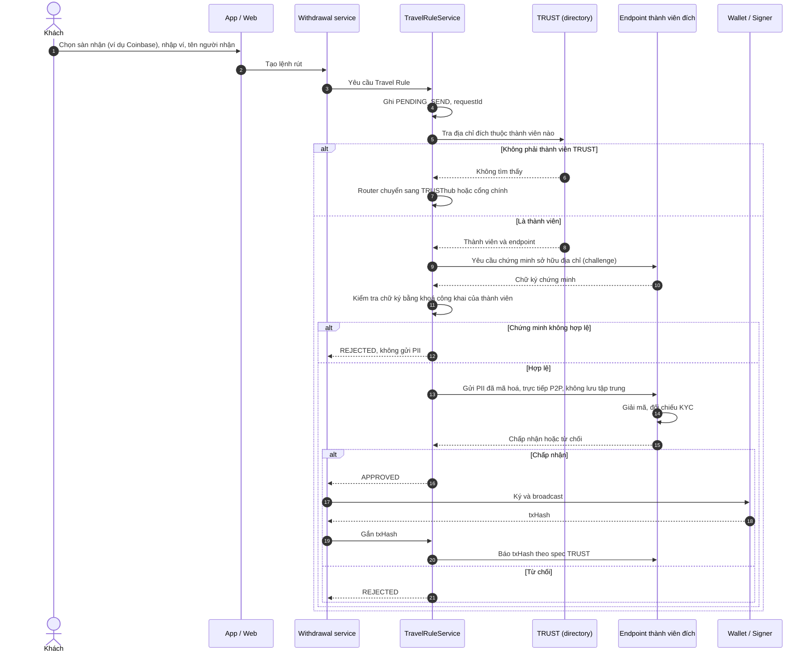

**Điểm cần lưu ý**

- Phải qua thẩm định AML, bảo mật và quyền riêng tư trước khi được nhận; VASP nhỏ có thể xin gói miễn phí.
- Sàn đích ngoài mạng: dùng TRUSThub (ra mắt 05/2026) hoặc chuyển sang cổng chính.
- 21 Analytics có kết nối TRUST sẵn, nhưng sàn vẫn phải tự xin làm thành viên.
- Theo Notabene, nhiều thành viên chưa chạy TRUST thật. Nên đo tỷ lệ phản hồi theo từng sàn và hạ ưu tiên kênh này nếu tỷ lệ thấp.

## Tích hợp qua Fireblocks

Với Fireblocks, sàn không gọi trực tiếp API của nhà cung cấp. Sàn làm ba việc: tạo **Travel Rule message (TRM)** qua API TRLink, mã hoá PII ngay phía mình, rồi gắn TRM vào giao dịch qua trường `travelRuleMessageId`. Phần còn lại do Fireblocks làm: chạy policy, **giữ giao dịch** cho tới khi có kết quả, chỉ ký khi được phép. Khoá broadcast vì thế có sẵn, sàn không phải tự dựng.

| Nhà cung cấp | Cách làm trong Fireblocks | Kết nối |
| --- | --- | --- |
| GTR | TRM mã hoá Curve25519 (`IVMS101.2020`), gắn vào giao dịch | Fireblocks Support bật; kết nối qua API bằng API key/secret GTR |
| Sumsub | TRM mã hoá JWS `RS256` lồng trong JWE `RSA-OAEP-256` + `A256GCM` (`IVMS101.2023`) | Fireblocks Support bật; Sumsub auto-connect |
| Notabene | Validate, mã hoá bằng PII SDK, gắn thẳng vào giao dịch qua `travelRuleMessage` | Fireblocks Support bật; kết nối trên Console |
| TRUST | Chỉ ký proof of address từ vault | Miễn phí, không cần bật |

**Quy tắc kết hợp:** một workspace chỉ bật một nhà cung cấp screening, trừ **Sumsub + GTR** chạy cùng nhau được. Notabene không chạy chung với Sumsub hay GTR. Nếu nhiều dòng tiền tới Binance, cặp Sumsub + GTR là lựa chọn phù hợp.

### Thiết lập một lần (Sumsub và GTR)

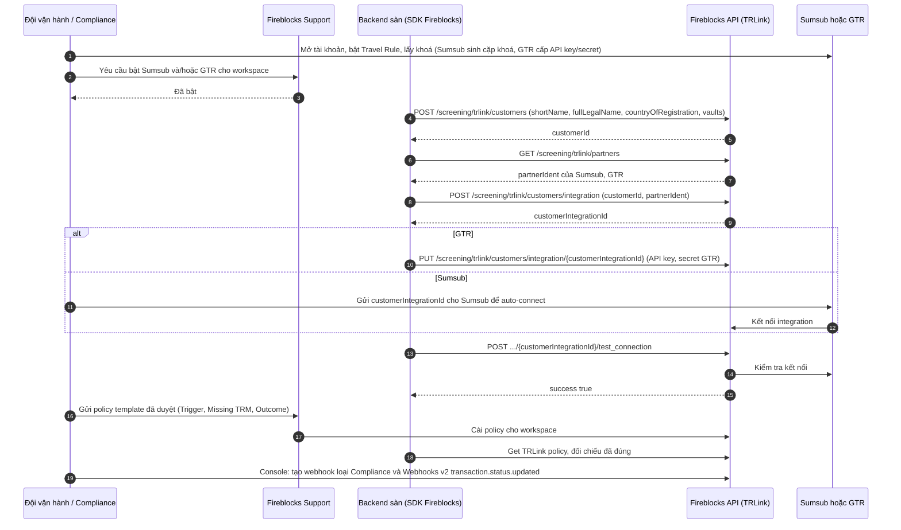

Policy chỉ Fireblocks Support cài được. Fireblocks giới hạn thời gian giữ giao dịch chiều ra tối đa 1,5 giờ. Ngắt kết nối hoặc xoá legal entity là không hoàn tác được.

### Luồng rút chuẩn (Sumsub và GTR)

Thứ tự bắt buộc: **assess → mã hoá PII → tạo TRM → tạo giao dịch có `travelRuleMessageId`**.

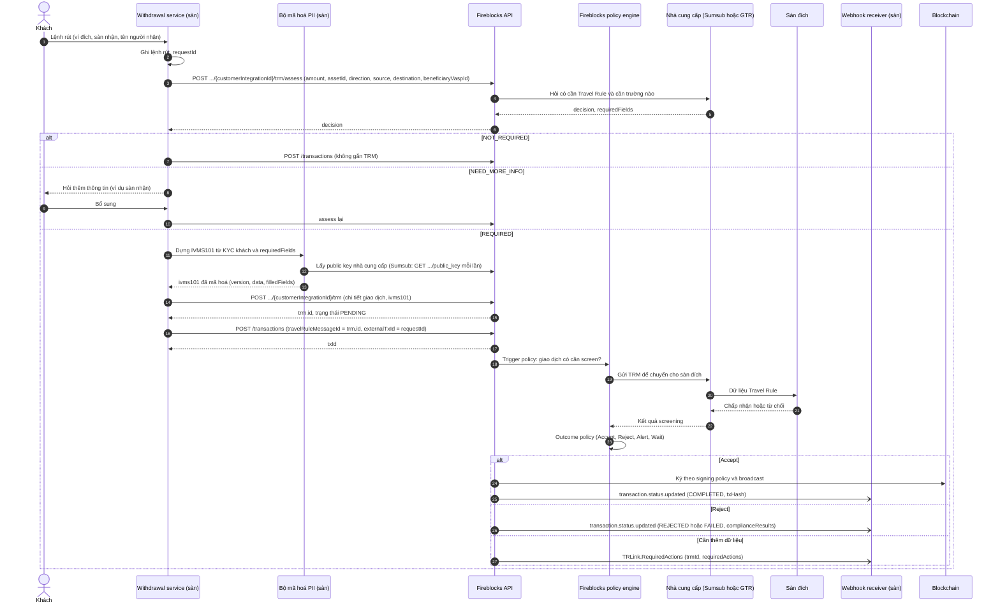

Nếu giao dịch đã tạo trước, gắn TRM sau bằng `POST /screening/trlink/transaction/{txId}/travel_rule_message_id`. Khách huỷ thì gọi `POST .../trm/{trmId}/cancel`; TRM đã huỷ không dùng lại được.

### Notabene qua Fireblocks

Notabene không dùng TRM qua TRLink. Sàn validate qua Fireblocks, mã hoá bằng PII SDK của Notabene, rồi gắn dữ liệu vào trường `travelRuleMessage` khi tạo giao dịch. **Lưu ý:** giao dịch rút không có `travelRuleMessage` sẽ đi thẳng, bỏ qua screening.

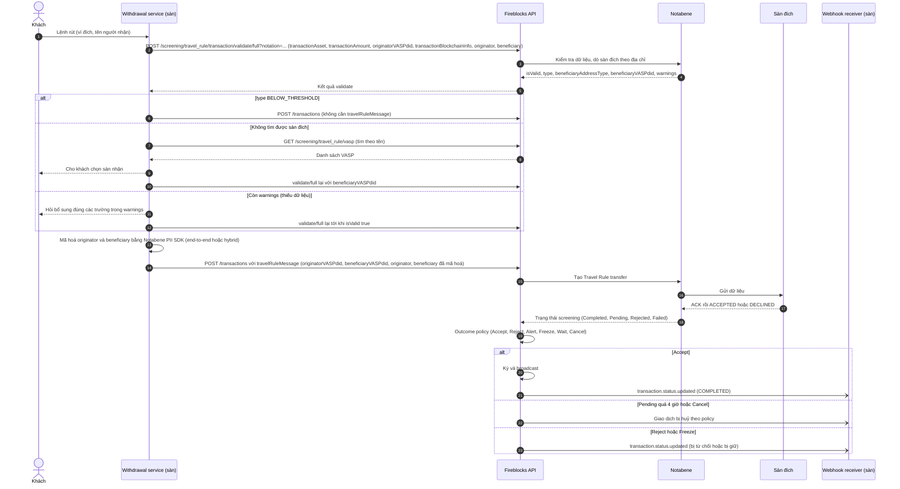

### TRUST qua Fireblocks (proof of address)

Fireblocks chỉ ký bằng chứng sàn kiểm soát một địa chỉ trong vault. Việc trao đổi dữ liệu với thành viên TRUST vẫn làm trực tiếp với TRUST.

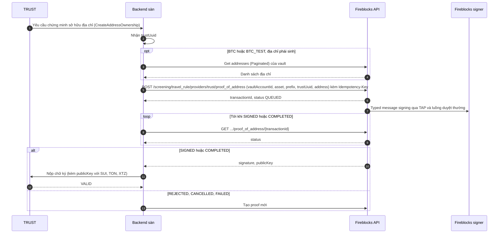

### Webhook và xử lý kết quả

Sàn phải đăng ký **cả hai** loại thông báo: Webhooks v2 `transaction.status.updated` (trạng thái giao dịch) và notification loại Compliance (`categoryId: "7"`), nơi có `TRLink.RequiredActions` và `TRLink.NoTRMessage` cho Sumsub/GTR.

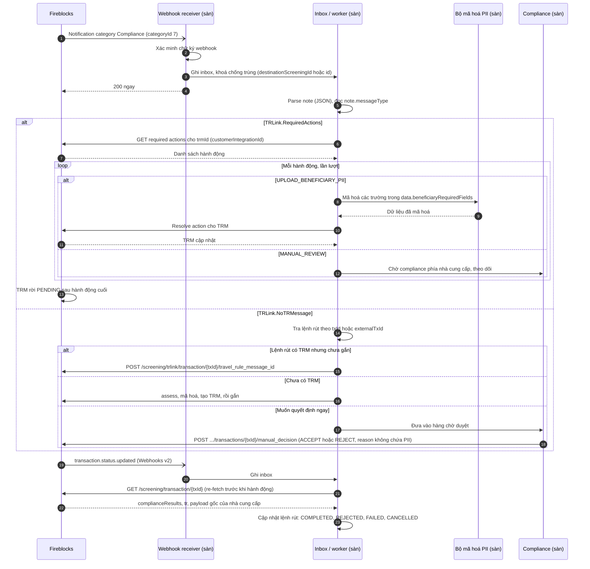

**Lỗi hay gặp khi đi qua Fireblocks**

- Tạo giao dịch mà quên gắn TRM: Sumsub/GTR báo `TRLink.NoTRMessage`; với Notabene giao dịch đi luôn không qua screening.
- Tạo trùng khi retry: đặt `externalTxId` = `requestId` và lưu `trm.id` trước khi tạo giao dịch.
- Mã hoá Sumsub lỗi do public key cũ: lấy lại public key mỗi lần mã hoá.
- `bypassScreeningDuringServiceOutages` mặc định `true`, nghĩa là nhà cung cấp sập thì giao dịch bỏ qua screening. Nên chốt với pháp chế có đặt `false` hay không.

## Binance đang triển khai Travel Rule như thế nào

Binance áp dụng Travel Rule ở hai lớp. **Giữa các sàn**, Binance trao đổi dữ liệu qua GTR, mạng do chính Binance lập ra. **Với khách hàng**, Binance bắt khai bảng hỏi (questionnaire) khi nạp và rút, mỗi pháp nhân địa phương một bảng theo luật nước đó.

### Giữa các sàn: qua GTR

- GTR do Infozone Technologies, một công ty thuộc Binance, vận hành. Mọi pháp nhân Binance trên thế giới đều nằm trong GTR.
- Sàn khác tới được Binance bằng cách tham gia GTR trực tiếp, hoặc đi qua các protocol GTR công bố có liên thông: Code, Sumsub, Sygna, Fireblocks.
- Sàn không thuộc mạng nào: GTR có Out-of-Network, gửi email bảo mật kèm link xem dữ liệu.

### Với khách hàng: bảng hỏi theo pháp nhân

Tài liệu API của Binance hiện liệt kê bảng hỏi rút tiền cho các pháp nhân ở Nhật, Kazakhstan, New Zealand, Bahrain, UAE, Ấn Độ, EU (Ba Lan, Pháp; mọi nước EU dùng chung), Nam Phi, Úc và Brazil.

| Chiều | Khách phải khai | Thiếu thông tin thì |
| --- | --- | --- |
| Rút | Ví có phải của mình (`isAddressOwner`), người nhận là cá nhân hay doanh nghiệp (`bnfType`), gửi tới sàn hay ví cá nhân (`sendTo`), sàn nhận (`vasp`, `vaspName`), tên và quốc gia người nhận; một số nơi cần thêm cam kết (`declaration`) | Không gửi được lệnh rút |
| Nạp | Thông tin người gửi và sàn gửi, khi sàn gửi không truyền dữ liệu Travel Rule | Khoản nạp bị treo tới khi khai xong |

Hai ví dụ gần đây:

- **Ấn Độ (từ 22/06/2026):** rút phải khai tên, quốc gia, thành phố người nhận và tên sàn nhận. Nạp phải khai tên người gửi, số PAN hoặc số định danh, và địa chỉ đầy đủ. Thiếu thông tin thì giao dịch không hoàn tất.
- **Brazil (từ 01/11/2026):** lệnh rút quốc tế thiếu thông tin bị chặn, khoản nạp thiếu thông tin bị treo. Chuyển tới bên không được phép trên thị trường ngoại hối Brazil bị giới hạn 100.000 USD mỗi giao dịch. Đây là quy định ngoại hối của Ngân hàng Trung ương Brazil, tách riêng khỏi Travel Rule; Travel Rule ở Brazil dự kiến áp dụng dần trong 2027–2028.

Mình chưa tìm thấy thông tin Binance áp dụng bảng hỏi cụ thể nào cho người dùng Việt Nam; cần kiểm tra trực tiếp trên tài khoản Binance hoặc thông báo chính thức.

### Ảnh hưởng tới lệnh rút từ sàn bạn sang Binance

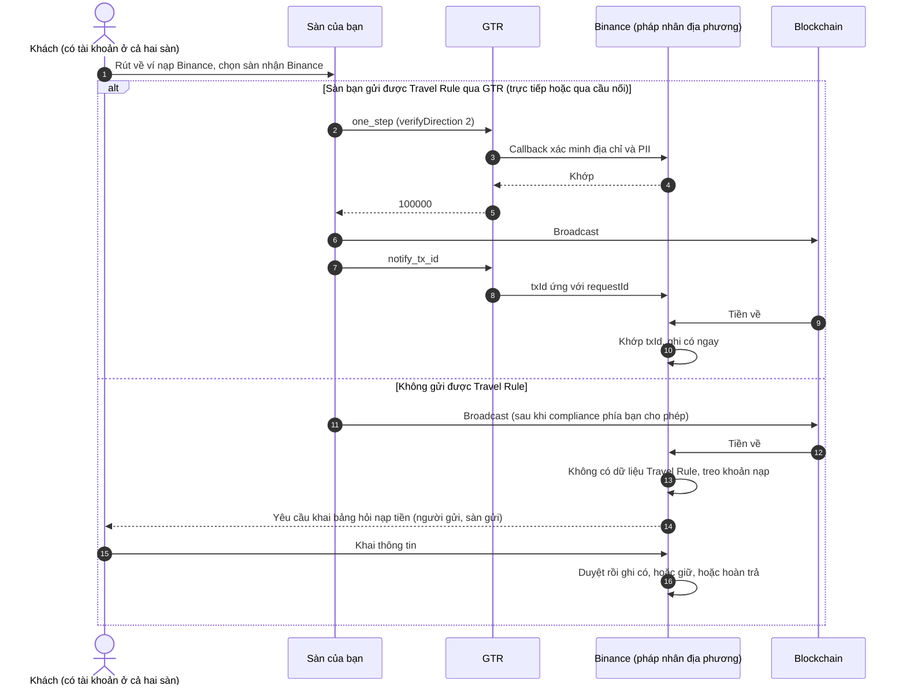

Nhánh thứ hai vẫn chạy được, nhưng tiền bị treo phía Binance và khách phải tự khai. Trải nghiệm kém và dễ sinh khiếu nại về phía sàn bạn. Vì vậy, nếu nhiều dòng tiền tới Binance, nên có kênh GTR: tham gia trực tiếp, hoặc bật GTR trên Fireblocks.

Chiều ngược lại (khách rút từ Binance về sàn bạn): khách phải chọn sàn nhận trong bảng hỏi của Binance. Nếu sàn bạn có trong danh sách VASP của GTR, dữ liệu sẽ tới qua callback. Nếu không có, khách thường phải nhập tay tên sàn, và sàn bạn không nhận được dữ liệu.

## Dữ liệu IVMS101

**IVMS101** (interVASP Messaging Standard 101) là chuẩn dữ liệu chung để mô tả người gửi và người nhận khi các sàn trao đổi Travel Rule. Chuẩn quy định sẵn cấu trúc, tên trường và định dạng, để mọi sàn và nhà cung cấp hiểu dữ liệu như nhau. Cả bốn nhà cung cấp và Fireblocks đều dùng chuẩn này.

| Nhóm | Ví dụ trường |
| --- | --- |
| Người gửi (Originator) | Họ tên, địa chỉ ví hoặc số tài khoản, địa chỉ nhà, số giấy tờ (CCCD, hộ chiếu), mã khách hàng, ngày và nơi sinh |
| Người nhận (Beneficiary) | Họ tên, địa chỉ ví |
| Sàn gửi / sàn nhận | Tên pháp nhân, mã định danh (LEI, số đăng ký kinh doanh), quốc gia |

Mỗi người được mô tả là cá nhân (`naturalPerson`) hoặc pháp nhân (`legalPerson`). Chuẩn định nghĩa đủ trường, còn mỗi khu vực pháp lý bắt buộc một tập con khác nhau. Ví dụ rút gọn:

```json
{
  "originator": {
    "originatorPersons": [{
      "naturalPerson": {
        "name": { "nameIdentifier": [{ "primaryIdentifier": "NGUYEN", "secondaryIdentifier": "VAN AN" }] },
        "dateAndPlaceOfBirth": { "dateOfBirth": "1990-05-12", "placeOfBirth": "Ha Noi" }
      }
    }],
    "accountNumber": ["0xAbc..."]
  },
  "beneficiary": {
    "beneficiaryPersons": [{
      "naturalPerson": {
        "name": { "nameIdentifier": [{ "primaryIdentifier": "TRAN", "secondaryIdentifier": "THI BINH" }] }
      }
    }],
    "accountNumber": ["0xDef..."]
  }
}
```

### IVMS101 (2020) và IVMS101.2023

|  | IVMS101 (2020) | IVMS101.2023 |
| --- | --- | --- |
| Phát hành | 05/2020 | 08/2023 (nháp tham vấn 07/2023, công bố rộng 06/2024) |
| Đơn vị duy trì | Joint Working Group on interVASP Messaging Standards | interVASP Standards Working Group (ISWG), thuộc Global Digital Finance |
| Mã phiên bản `payloadVersion` | `101` | `101.2023` |
| Bản chất | Bản gốc | Cập nhật dẫn xuất từ bản gốc: sửa lỗi, gỡ vướng mắc khi triển khai, bổ sung cải tiến |
| Ai đang dùng | Phổ biến nhất; GTR dùng `ivms101-2020` | Đang áp dụng dần; Sumsub qua Fireblocks dùng `IVMS101.2023` |

Bản 2023 nêu rõ các điểm sau:

- `payloadVersion` bắt buộc, để bên nhận biết cách đọc gói dữ liệu.
- Hướng dẫn chuyển tự chi tiết: dữ liệu UTF-8, chữ Latin là mặc định; tên bằng chữ không phải Latin phải chuyển tự hoặc gửi trong trường "local"; có bảng mã chữ viết theo ISO 15924.
- Ràng buộc dữ liệu viết rõ hơn: ngày sinh ở quá khứ (`YYYY-MM-DD`), địa chỉ phải có `addressLine` hoặc tên đường kèm số nhà, LEI đúng 20 ký tự.
- Có thêm ví dụ payload mẫu để kiểm thử.

Bản 2023 không kèm danh sách thay đổi chính thức từng trường. Muốn so sánh chi tiết thì cần đặt hai bản chuẩn cạnh nhau (tải tại intervasp.org).

**Ý nghĩa với sàn:**

- Hai phiên bản không tương thích tự động; nhà cung cấp tự chuyển đổi giữa các bên. Sàn chỉ cần dựng dữ liệu đúng phiên bản nhà cung cấp của mình yêu cầu.
- Bộ dựng IVMS101 nên nhận phiên bản làm tham số và sinh `filledFields` tự động, vì qua Fireblocks thì Sumsub dùng 2023 còn GTR dùng 2020.
- Tên tiếng Việt dùng chữ Latin nên không cần chuyển tự, nhưng nên gửi dạng **không dấu, viết hoa** để sàn đích so khớp tên dễ đạt.

## Sumsub qua cầu nối GTR tới được những sàn nào

Qua cầu nối GTR của Sumsub, sàn với tới các **thành viên mạng GTR**. Trang chủ GTR hiện liệt kê 13 thành viên liên minh; 21 Analytics ghi nhận khoảng 30 VASP thành viên trực tiếp vào 12/2025, nên danh sách đầy đủ cần hỏi GTR hoặc Sumsub.

| Thành viên GTR | Ghi chú |
| --- | --- |
| Binance | Mọi pháp nhân Binance trên thế giới |
| OKX, Bybit, Bitget, Gate.io, BingX | Sàn giao dịch |
| HashKey Exchange | Hồng Kông |
| Ceffu | Đơn vị lưu ký, trước đây là Binance Custody |
| Circle | Bên phát hành USDC; cũng thuộc TRUST |
| CoinSwitch | Ấn Độ |
| CoinTR | Thổ Nhĩ Kỳ |
| DTC Pay, Paymonade | Thanh toán |

**Mức độ đáp ứng chưa rõ.** Tài liệu của Sumsub đang nói hai kiểu:

- Trang GTR protocol mô tả "challenge flow": chỉ áp dụng cho lệnh rút đi, chỉ so khớp **tên và ngày sinh đã băm** (Keccak-256), trả về `nameMatch` và `dobMatch`. Sumsub ghi rõ luồng này không được coi là giải pháp đáp ứng Travel Rule.
- Trang danh sách protocol và trang luồng rút tiền lại coi GTR là kênh trao đổi dữ liệu như CODE và Sygna.

Vì vậy, với lệnh rút tới Binance hay OKX qua Sumsub:

- **Chắc chắn được:** xác thực tên người nhận có khớp với chủ ví ở sàn đích.
- **Chưa chắc:** gói dữ liệu IVMS101 đầy đủ có tới sàn đích không. Nếu không, sàn đích có thể vẫn treo khoản nạp và bắt khách tự khai (như Binance đang làm), và có thể không đủ với khu vực bắt buộc truyền đủ dữ liệu như EU.

**Cần hỏi Sumsub bằng văn bản:**

1. Cầu nối GTR hiện truyền đủ dữ liệu IVMS101 hay chỉ chạy challenge flow?
2. Lệnh rút tới Binance qua Sumsub có được Binance ghi có tự động, không cần khách khai bảng hỏi không?
3. Danh sách đầy đủ VASP đang với tới được qua GTR?

Nếu chỉ là challenge flow, đường chắc chắn hơn là kết nối GTR trực tiếp. Trên Fireblocks có thể bật cả Sumsub và GTR cùng lúc.

## Nếu chỉ chọn một nhà cung cấp

**Qua Fireblocks: chọn Sumsub. Không qua Fireblocks: chọn Sumsub nếu Binance và các sàn GTR chiếm phần lớn dòng rút, ngược lại chọn Notabene.** Hai bước cần làm trước khi chốt: thống kê dòng rút theo sàn đích trong 3–6 tháng gần nhất, và hỏi Sumsub về mức hỗ trợ GTR (phần trên).

### Khi tích hợp qua Fireblocks

- **Phủ rộng trong một lần tích hợp:** mạng \~2.100+ VASP, cầu nối GTR, CODE, Sygna, TRP, kèm email dự phòng.
- **Không khoá đường mở rộng:** đây là điểm quyết định. Sumsub chạy chung được với GTR trên cùng workspace. Chọn Notabene thì không bao giờ bật được Sumsub hay GTR nữa.
- **Dùng đúng luồng TRM chuẩn của Fireblocks:** Fireblocks giữ giao dịch cho tới khi có kết quả.
- **Tận dụng được KYC** nếu sàn dùng Sumsub cho KYC.

| Bên | Vì sao không chọn làm bên duy nhất trên Fireblocks |
| --- | --- |
| Notabene | Loại trừ hẳn Sumsub và GTR; không nối trực tiếp tới Binance (GTR) hay TRUST |
| GTR | Chỉ khoảng 30 thành viên trực tiếp; sàn ngoài mạng chỉ còn đường email |
| TRUST | Mạng đóng, phải qua thẩm định; trên Fireblocks chỉ ký bằng chứng sở hữu ví, không có screening |

Nếu cầu nối GTR của Sumsub chỉ để xác thực **và** Binance cùng các sàn GTR chiếm phần lớn khối lượng, nên tính sẵn việc bật thêm GTR: cấu hình đích là Sumsub + GTR.

### Khi tự tích hợp, không qua Fireblocks

Không còn ràng buộc "một nhà cung cấp mỗi workspace", nên chọn bên nào trước cũng có thể nối thêm GTR trực tiếp về sau.

| Tiêu chí | Sumsub | Notabene |
| --- | --- | --- |
| Tới Binance và sàn GTR | Có cầu nối GTR được công bố (mức độ cần xác nhận) | Chưa có xác nhận công khai về kết nối GTR |
| Mạng lưới | \~2.100+ VASP | \~2.000+ VASP đã xác minh, tỷ lệ xử lý tự động \~85% |
| Sàn đích chưa tích hợp | Gửi email, lưu bằng chứng | TR:Now: sàn đích phản hồi thủ công, không mất phí |
| Giá | Không công khai, theo khối lượng | Gói Sunrise miễn phí (gửi tới 10.000 USD/tháng); trả phí theo khối lượng gửi đi |
| KYC | Tái dùng hồ sơ KYC Sumsub | Chỉ làm Travel Rule, không ràng buộc vendor KYC |

Gợi ý: Binance cùng các sàn GTR chiếm trên khoảng một nửa khối lượng rút thì chọn Sumsub; thấp hơn thì chọn Notabene, rồi nối thêm GTR trực tiếp khi cần. Ngưỡng một nửa là mốc gợi ý để dễ quyết định, không phải chuẩn ngành.

Khi tự tích hợp, sàn phải tự làm những việc Fireblocks đang làm sẵn:

- Khoá ký và broadcast ở tầng ký giao dịch, chỉ mở khi `APPROVED` hoặc `NOT_REQUIRED`.
- Webhook (xác minh chữ ký, chống trùng), job đối soát, outbox retry với cùng `requestId`.
- Báo txHash sau broadcast và huỷ khi khách bỏ lệnh.

## Nguồn tham khảo

| Nhóm | Tài liệu |
| --- | --- |
| Notabene | [Generate accessToken](https://devx.notabene.id/v1.0/docs/auth0) · [Create transfer](https://devx.notabene.id/reference/txcreate-1) · [Travel Rule statuses](https://devx.notabene.id/docs/tr-status_vnext) · [System interactions](https://devx.notabene.id/docs/how-does-our-apis-interact-with-your-system) · [Notification webhook](https://devx.notabene.id/v1.0/docs/updating) · [TR:Now và giá](https://notabene.id/travel-rule-messaging-protocols/tr-now) |
| Sumsub | [Quickstart](https://docs.sumsub.com/docs/travel-rule-quickstart-guide) · [Authentication](https://docs.sumsub.com/reference/authentication) · [Start exchange before settlement](https://docs.sumsub.com/docs/start-exchange-before-settlement) · [Webhook manager](https://docs.sumsub.com/docs/webhook-manager) · [GTR protocol](https://docs.sumsub.com/docs/gtr-protocol) · [Self-Service (05/2026)](https://sumsub.com/newsroom/sumsub-launches-self-service-setup-for-travel-rule-compliance/) |
| GTR | [Before Integration](https://www.globaltravelrule.com/documentation/before-integration) · [Authentication](https://www.globaltravelrule.com/documentation/authentication) · [Submit One Step Travel Rule](https://www.globaltravelrule.com/documentation/api-references/gtr-2-0-sync-api/post-api-verify-v-2-one-step) · [Address Existence Verify Callback](https://www.globaltravelrule.com/documentation/callback-api-references/callback-api/post-address-exists-verify-6) · [PII Verification Callback](https://www.globaltravelrule.com/documentation/callback-api-references/callback-api/post-pii-verify-4) · [Subscription](https://www.globaltravelrule.com/documentation/subscription) · [Trang chủ (thành viên, protocol liên thông)](https://www.globaltravelrule.com/en/home) |
| TRUST | [Coinbase – TRUST](https://www.coinbase.com/travelrule) · [Expanding TRUST (05/2026)](https://www.coinbase.com/blog/expanding-trust-a-privacy-first-network-for-global-crypto-compliance) · [No-fee membership](https://www.coinbase.com/blog/trust-now-offering-no-fee-memberships-to-qualifying-members) · [Notabene – phân tích TRUST](https://notabene.id/travel-rule-messaging-protocols/ustrwg) · [21 Analytics – TRUST](https://www.21analytics.co/coinbase-trust/) |
| Fireblocks | [Travel Rule Overview](https://developers.fireblocks.com/docs/travel-rule-overview.md) · [GTR](https://developers.fireblocks.com/docs/gtr.md) · [Sumsub](https://developers.fireblocks.com/docs/sumsub.md) · [Notabene](https://developers.fireblocks.com/docs/notabene.md) · [TRUST proof of address](https://developers.fireblocks.com/docs/interact-with-trust.md) · [Compliance Policies](https://developers.fireblocks.com/docs/compliance-policies.md) · [Compliance Events & Webhooks](https://developers.fireblocks.com/docs/compliance-events-webhooks.md) |
| Binance | [Withdraw Questionnaire](https://developers.binance.com/docs/wallet/travel-rule/withdraw-questionnaire) · [Deposit Questionnaire](https://developers.binance.com/en/docs/products/wallet/travel-rule/deposit-questionnaire) · [21 Analytics – GTR, Binance Travel Rule](https://www.21analytics.co/glossary/gtr-binance-travel-rule/) · [Binance Ấn Độ (06/2026)](https://license.aiying.cc/en/india/binance-india-crypto-transfer-counterparty-reporting-travel-rule/) · [Binance Brazil (11/2026)](https://www.tokenpost.com/news/regulation/26387) · [Sumsub tích hợp với Binance qua GTR](https://thefintechtimes.com/sumsub-integrates-travel-rule-solution-with-binance/) |

IVMS101: [IVMS 101.2023 – bản chính thức (PDF)](https://cdn.prod.website-files.com/648841abc97f28489cc3f2ce/6656e9c60c3029989dcd7431_IVMS101.2023%20interVASP%20data%20model%20standard.pdf) · [IVMS 101.2023 – bản nháp tham vấn (PDF)](https://www.gdf.io/wp-content/uploads/2020/12/IVMS101.2023-Working-Draft-For-Consultation.pdf) · [VASPnet – ISWG cập nhật IVMS101](https://vaspnet.com/articles/intervasp-standards-working-group-updates-global-language-vasps-use-to-communicate-mandated-travel-rule-data) · [interVASP Messaging](https://www.intervasp.org/) · [CODE – IVMS101](https://docs-en.codevasp.com/docs/ivms101) · [Sumsub – Protocols](https://docs.sumsub.com/docs/protocols)
