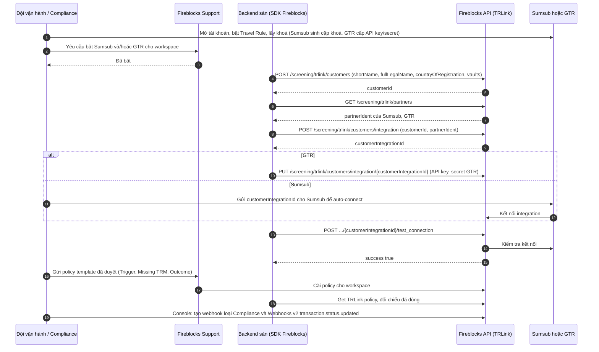
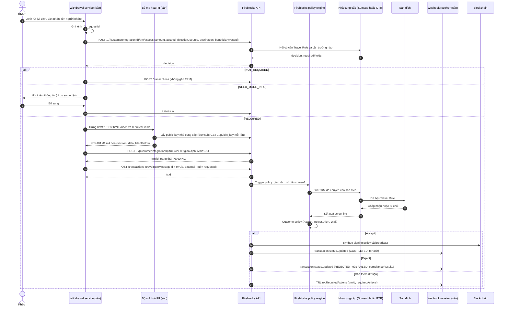
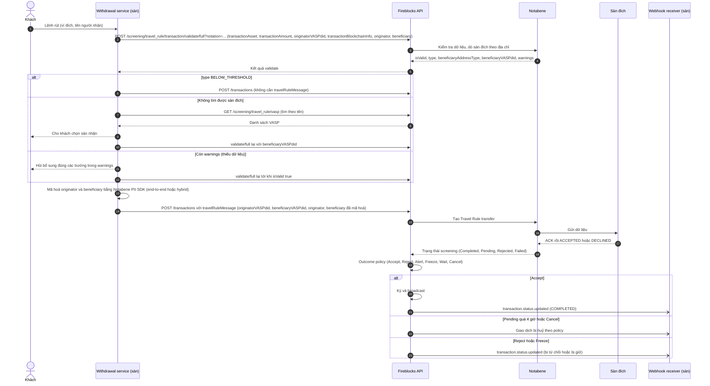
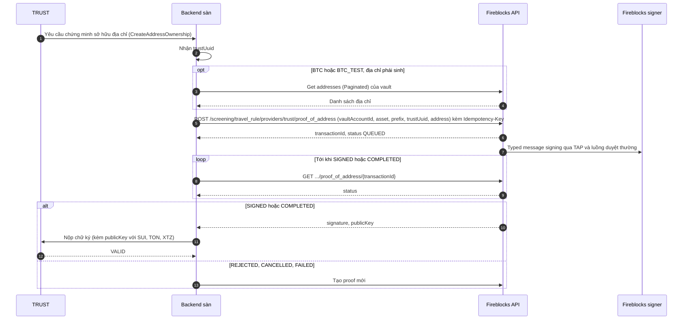
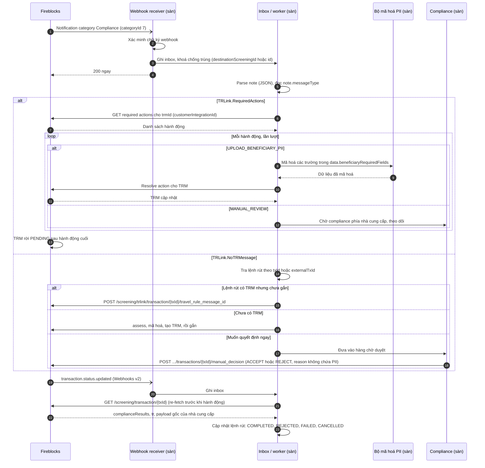

# Tích hợp Travel Rule cho luồng rút tiền qua Fireblocks

Nov 5, 2026 · @Mincuk

## Tổng quan

Với Fireblocks, sàn **không gọi trực tiếp API của nhà cung cấp Travel Rule** cho lệnh rút. Sàn tạo một Travel Rule message (TRM) qua API TRLink của Fireblocks, mã hoá PII ngay phía mình, rồi gắn TRM vào giao dịch Fireblocks qua trường `travelRuleMessageId`. Fireblocks chạy screening theo policy của workspace, chuyển TRM cho nhà cung cấp gửi tới sàn đích, và **giữ giao dịch lại** cho tới khi có kết quả. Khóa broadcast vì thế nằm ngay trong Fireblocks, không phải tự dựng.

Fireblocks không giữ khoá giải mã PII với Notabene, Sumsub và GTR. Vì vậy việc tạo và gắn TRM chỉ làm được qua API.

### Nhà cung cấp dùng được trong Fireblocks

| Nhà cung cấp | Cách tích hợp trong Fireblocks | Bật và kết nối | Phí |
| --- | --- | --- | --- |
| GTR | Tạo TRM mã hoá (Curve25519), gắn vào giao dịch | Fireblocks Support bật; kết nối qua API bằng API key/secret GTR | Premium add-on của Fireblocks, cộng gói GTR |
| Sumsub | Tạo TRM mã hoá (JWS lồng trong JWE), gắn vào giao dịch | Fireblocks Support bật; kết nối qua API, Sumsub auto-connect | Premium add-on của Fireblocks, cộng hợp đồng Sumsub |
| Notabene | Xác thực và mã hoá dữ liệu, gắn vào giao dịch rút | Fireblocks Support bật; kết nối trên Console | Hợp đồng Notabene |
| TRUST | Ký proof of address từ vault account và công bố | Không cần bật | Miễn phí trên Fireblocks |

**Quy tắc kết hợp:** một workspace chỉ bật được **một** nhà cung cấp screening, trừ trường hợp **Sumsub và GTR chạy cùng nhau**. Notabene không chạy chung với Sumsub hay GTR. TRUST dùng được cùng bất kỳ nhà cung cấp nào, nhưng chỉ làm phần proof of address, không có screening policy.

Chuyển tiền tới các sàn đã kết nối vào workspace (connected exchanges) và lệnh on/off-ramp dùng luồng riêng của Fireblocks, không thuộc phạm vi tài liệu này.

### Nên chọn tổ hợp nào

| Tổ hợp | Phủ được | Phù hợp khi |
| --- | --- | --- |
| **Sumsub + GTR** (khuyến nghị nếu nhiều dòng tiền tới Binance) | GTR trực tiếp tới Binance và thành viên GTR; Sumsub phủ phần còn lại qua nhiều protocol | Hai nhóm sàn đích lớn nhất là hệ Binance và các sàn khác |
| **Notabene** | Một cổng, mạng \~2.000+ VASP | Muốn ít công tích hợp nhất, chấp nhận không có GTR trực tiếp |
| Cộng thêm **TRUST** | Proof of address cho thành viên TRUST (Coinbase, Kraken…) | Sàn của bạn là thành viên TRUST |

### Khái niệm dùng trong tài liệu

| Khái niệm | Ý nghĩa |
| --- | --- |
| TRLink | Bộ API của Fireblocks để làm việc với nhà cung cấp Travel Rule, dưới đường dẫn `/screening/trlink/...` |
| Travel Rule legal entity | Pháp nhân của sàn khai với TRLink; mỗi khu vực pháp lý có thể có một entity gắn với một nhóm vault |
| `customerIntegrationId` | Mã kết nối giữa một legal entity và một nhà cung cấp; dùng trong mọi lời gọi TRM |
| TRM | Travel Rule message: dữ liệu IVMS101 đã mã hoá của một giao dịch. Trạng thái `PENDING`, `ACCEPTED`, `REJECTED`, `FAILED` |
| `travelRuleMessageId` | Trường trên giao dịch Fireblocks dùng để gắn TRM |
| Policy | Luật screening của workspace: Trigger, Missing Travel Rule Message, Outcome. Fireblocks Support là bên cài đặt |

## Thiết lập một lần

Sumsub và GTR dùng chung một quy trình kết nối qua API TRLink. Notabene kết nối trên Console. TRUST không cần kết nối.

### Sumsub và GTR



Lưu ý khi thiết lập:

- **Legal entity:** đúng một entity không giới hạn vault, để bao các vault chưa gán. Nếu sàn có nhiều pháp nhân theo khu vực, tạo thêm entity và gán vault tương ứng. Trường `discoverable` chọn `anonymous` (mặc định), `hidden` hoặc `discoverable`.
- **Khoá:** Sumsub tự sinh cặp khoá, sàn không upload khoá riêng được. GTR cần cặp khoá ED25519, public key khai trên dashboard GTR, private key dùng để giải mã dữ liệu về. Cả hai loại private key đều phải nằm trong KMS/HSM của sàn.
- **Policy:** chỉ Fireblocks Support cài được, sàn đọc lại qua API. Fireblocks giới hạn thời gian giữ giao dịch tối đa **1,5 giờ cho chiều ra** và 7 ngày cho chiều vào.
- **Không thể hoàn tác:** ngắt kết nối sẽ xoá hẳn credential và integration, TRM đang chờ có thể lỗi. Xoá legal entity sẽ xoá luôn integration, TRM và cấu hình.

### Notabene

1. Lấy VASP DID: `GET /screening/travel_rule/vasp`.
2. Tạo khoá DID Ed25519 bằng Notabene CLI, đăng ký qua `PUT /screening/travel_rule/vasp/update`.
3. Gán VASP DID cho mọi vault nhận tiền. Vault chưa gán DID thì tiền về không được screening.
4. Trên Console, kết nối Notabene bằng API key, secret và VASP DID. Có email báo khi kết nối được duyệt.
5. Trên dashboard Notabene, chọn trạng thái mà Fireblocks coi là "screening xong".
6. Dựng Trigger và Outcome policy trên Console; nếu không tự dựng thì áp dụng luật mặc định.

Mặc định Notabene production nối với Fireblocks production, sandbox nối với sandbox.

### TRUST

Không cần bật. Cần: SDK Fireblocks, prefix của sàn trên TRUST, và Transaction Authorization Policy cho phép giao dịch ký typed message, vì proof đi qua luồng duyệt và ký thông thường.

## Luồng rút chuẩn qua Fireblocks

Với Sumsub và GTR, thứ tự bắt buộc là **assess → mã hoá PII → tạo TRM → tạo giao dịch có `travelRuleMessageId`**. Sau đó Fireblocks tự chạy policy, giữ giao dịch, chuyển TRM cho nhà cung cấp và chỉ ký khi Outcome policy cho phép. Backend của sàn không phải tự khoá broadcast; việc còn lại là theo dõi webhook và xử lý các trường hợp cần thêm dữ liệu.



### Từng bước và trường dữ liệu

| Bước | API Fireblocks | Trường chính | Ghi chú |
| --- | --- | --- | --- |
| 1. Đánh giá | `POST /screening/trlink/customers/integration/{customerIntegrationId}/trm/assess` | `amount`, `assetId`, `direction`, `source`, `destination`, `beneficiaryVaspId` | `decision`: `REQUIRED`, `NOT_REQUIRED`, `NEED_MORE_INFO`; khi `REQUIRED` có `requiredFields` (đường dẫn IVMS101) |
| 2. Mã hoá PII | Phía sàn | `ivms101.version`, `ivms101.data`, `ivms101.filledFields` | Cách mã hoá khác nhau theo nhà cung cấp (phần sau) |
| 3. Tạo TRM | `POST .../{customerIntegrationId}/trm` | Chi tiết giao dịch như bước 1 + `ivms101` | Trả về `id` của TRM |
| 4. Tạo giao dịch | `POST /transactions` | `travelRuleMessageId` = id của TRM; nên đặt `externalTxId` = `requestId` | `externalTxId` giúp chống tạo trùng giao dịch khi retry |
| 4b. Gắn sau (nếu giao dịch đã có) | `POST /screening/trlink/transaction/{txId}/travel_rule_message_id` | id của TRM | Nhiều đích: `.../destination/travel_rule_message_id`, khớp theo `amount` và `destination` |
| 5. Theo dõi | Webhook + `GET /screening/transaction/{txId}` | `complianceResults`, trường `tr` | Chi tiết ở phần Webhook |

Giao dịch gửi lên mà **không gắn TRM** vẫn bị Trigger policy bắt nếu cần Travel Rule. Với Sumsub và GTR, giao dịch đó sẽ nằm ở bước Missing Travel Rule Message và Fireblocks gửi webhook `TRLink.NoTRMessage`. Với Notabene thì khác: giao dịch rút không có `travelRuleMessage` sẽ **đi thẳng, bỏ qua screening**. Luồng rút của sàn vì vậy phải luôn tạo TRM trước với cả ba nhà cung cấp.

## Chi tiết theo nhà cung cấp

GTR và Sumsub đi đúng luồng chuẩn ở trên và chỉ khác nhau ở **cách mã hoá PII**. Notabene và TRUST có luồng riêng nên có sơ đồ riêng.

### GTR

| Hạng mục | Chi tiết |
| --- | --- |
| Khoá | Cặp ED25519 của sàn, chuyển sang Curve25519 khi mã hoá; public key của GTR lấy trong cài đặt integration GTR |
| Mã hoá | Curve25519, dùng tool mã nguồn mở của GTR; GTR từ chối PII dạng plain text |
| `ivms101` | `version` = `IVMS101.2020`, `data` = chuỗi đã mã hoá, `filledFields` = danh sách trường đã điền (dạng `Originator.originatorPerson[].naturalPerson.name.nameIdentifier[].primaryIdentifier`) |
| Thao tác TRM khác | `GET .../trm/{trmId}`, `POST .../trm/{trmId}/cancel` (báo huỷ cho sàn đích, TRM đã huỷ không dùng lại được), `POST .../trm/{trmId}/redirect` (chuyển sang VASP con) |
| Kiểm thử | Dùng tài sản Testnet; Console → Transaction History hiển thị policy đã áp và phản hồi của GTR |

### Sumsub

| Hạng mục | Chi tiết |
| --- | --- |
| Khoá | Sumsub sinh cặp khoá cho sàn; sàn không tự upload khoá được |
| Mã hoá | JWT lồng: JWS ký `RS256` bằng private key của sàn, bọc trong JWE `RSA-OAEP-256` + `A256GCM` bằng public key của Sumsub |
| Public key Sumsub | Lấy lại **trước mỗi lần mã hoá** vì có thể đổi: `GET /screening/trlink/customers/integration/{customerIntegrationId}/public_key` |
| `ivms101` | `version` = `IVMS101.2023`, `data` = compact JWE, `filledFields` |
| Thao tác TRM khác | Như GTR: get, cancel, redirect |

Mã hoá cho Sumsub bằng Java (thư viện `com.nimbusds:nimbus-jose-jwt`), để tham khảo; tài liệu Fireblocks có bản mẫu chính thức bằng Node.js:

```java
public String sealForSumsub(String ivms101Json, RSAPrivateKey ourKey, RSAPublicKey sumsubKey)
        throws JOSEException {
    // Lớp trong: ký bằng private key của sàn
    JWSObject jws = new JWSObject(new JWSHeader(JWSAlgorithm.RS256), new Payload(ivms101Json));
    jws.sign(new RSASSASigner(ourKey));

    // Lớp ngoài: mã hoá bằng public key Sumsub vừa lấy từ Fireblocks
    JWEObject jwe = new JWEObject(
            new JWEHeader.Builder(JWEAlgorithm.RSA_OAEP_256, EncryptionMethod.A256GCM)
                    .contentType("JWT").build(),
            new Payload(jws));
    jwe.encrypt(new RSAEncrypter(sumsubKey));
    return jwe.serialize();   // đặt vào ivms101.data
}
```

### Notabene

Notabene không dùng TRM qua API TRLink. Sàn gọi API validate của Fireblocks, mã hoá bằng PII SDK của Notabene, rồi gắn dữ liệu thẳng vào giao dịch qua trường `travelRuleMessage`.



| Hạng mục | Chi tiết |
| --- | --- |
| Tham số `notation` | Phải đặt rõ khi gọi `validate/full`. Mặc định hiện là `notabene` và sẽ đổi sang `fireblocks`. API validate cơ bản đang bị ngừng |
| `type` | `BELOW_THRESHOLD` (không cần dữ liệu), `TRAVELRULE`, `NON_CUSTODIAL` |
| `beneficiaryAddressType` | `HOSTED`, `UNHOSTED`, `UNKNOWN` |
| Mã hoá | Notabene PII SDK: end-to-end (chỉ sàn đích giải mã được) hoặc hybrid (Notabene cũng giải mã được) |
| Trạng thái screening | Completed, Pending (chờ tối đa 4 giờ rồi tự huỷ), Rejected, Failed, Blocking time expired, Canceled |
| Không được screening | Vault → vault, vault → exchange, liên quan Gas Station, non-custodial → non-custodial trong cùng workspace |
| Kiểm thử | RoboVASP của Notabene, Postman collection Fireblocks–Notabene. Testnet hỗ trợ `BTC_TEST`, `ETH_TEST5`, `XRP_TEST` |

### TRUST (proof of address)

TRUST trên Fireblocks chỉ làm một việc: ký bằng chứng rằng sàn kiểm soát một địa chỉ trong vault. Việc trao đổi dữ liệu Travel Rule với thành viên TRUST vẫn do sàn làm trực tiếp với TRUST (ngoài Fireblocks). Trong luồng rút, bước này dùng khi TRUST yêu cầu sàn chứng minh địa chỉ của mình, ví dụ địa chỉ hot wallet gửi tiền.



Giới hạn: chỉ chứng minh được địa chỉ mặc định của vault, trừ BTC/BTC\_TEST có thể chứng minh địa chỉ phái sinh đã tồn tại. `Idempotency-Key` có hiệu lực 24 giờ.

## Webhook và xử lý kết quả

Sàn nhận hai loại thông báo từ Fireblocks và phải đăng ký **cả hai**:

| Loại | Cách đăng ký | Dùng để |
| --- | --- | --- |
| Webhooks v2: `transaction.status.updated` | Tạo endpoint và subscribe sự kiện | Theo dõi trạng thái giao dịch rút; `data` là toàn bộ giao dịch, kết quả từng check nằm trong `complianceResults` |
| Notification loại Compliance (`categoryId: "7"`) | Console → Settings → Notifications → Webhooks → Create Webhook → chọn Compliance | Nhận `TRLink.RequiredActions` và `TRLink.NoTRMessage` (Sumsub, GTR). Đây là audit-log notification, không phải sự kiện Webhooks v2 |



### Nội dung các thông báo Travel Rule

| `note.messageType` | Trường | Ý nghĩa và cách xử lý |
| --- | --- | --- |
| `TRLink.RequiredActions` | `trmId`, `customerIntegrationId`, `requiredActions[]` (`type`, `description`, `data`), `destinationScreeningId` (tuỳ chọn) | Gửi một lần cho mỗi đích khi TRM cần thêm dữ liệu. Giải quyết từng hành động một; mỗi lần trả về TRM đã cập nhật |
| `TRLink.NoTRMessage` | `txId`, `destinationScreeningId`, thông tin đích | Giao dịch cần TRM nhưng chưa có. Giao dịch chờ ở bước Missing Travel Rule Message tới khi có TRM hoặc hết giờ theo policy |

### Quyết định thủ công (`manual_decision`)

- Áp dụng cho mọi đích đang ở bước Missing Travel Rule Message; báo lỗi nếu không còn đích nào ở bước đó.
- Gửi lại cùng hành động không có tác dụng; gửi hành động khác sẽ thay quyết định cũ.
- Khi một đích đã rời bước này, không đổi được nữa.
- Được ghi nhận với `source: "MANUAL"`. Trường `reason` tối đa 500 ký tự, **không được chứa PII**.

### Quy tắc xử lý webhook theo khuyến nghị của Fireblocks

1. Xác minh chữ ký trước khi xử lý (theo trang "Validating webhooks" của Fireblocks).
2. Trả `200` ngay, xử lý bất đồng bộ.
3. Không giả định sự kiện đến đúng thứ tự; luôn so với trạng thái hiện tại.
4. Chống trùng theo `id` của notification; với thông báo Travel Rule dùng `destinationScreeningId` nếu có.
5. Đọc lại trạng thái qua API trước khi bypass, rescreen, unfreeze hoặc gửi quyết định.
6. Webhooks v2 gửi lại được thông báo trong 30 ngày, dùng để bù sự kiện bị mất.

Đường dẫn chính xác của API "Get required actions" và "Resolve action" cho TRM cần lấy trong API Reference của Fireblocks; trang hướng dẫn chưa ghi đường dẫn.

## Sự cố cần cover

Nhờ Fireblocks giữ giao dịch theo policy, rủi ro "broadcast khi chưa xong Travel Rule" đã được khoá sẵn. Các sự cố còn lại nằm ở phía backend của sàn: gắn TRM, mã hoá, webhook và cấu hình.

| Sự cố | Dấu hiệu | Cách xử lý |
| --- | --- | --- |
| Tạo giao dịch mà quên gắn TRM | Sumsub/GTR: `TRLink.NoTRMessage`. Notabene: giao dịch đi luôn không qua screening | Code rút tiền chặn cứng: không gọi `POST /transactions` khi `assess` trả `REQUIRED` mà chưa có TRM. Với Notabene đây là lỗi nghiêm trọng vì không có lớp bắt lại |
| Tạo trùng TRM hoặc giao dịch khi retry | Hai giao dịch cùng một lệnh rút | Đặt `externalTxId` = `requestId`; lưu `trm.id` vào lệnh rút trước khi gọi `POST /transactions`; retry thì tái dùng TRM đã có |
| `assess` trả `NEED_MORE_INFO` | Thiếu sàn đích hoặc thông tin | Hỏi khách đúng trường còn thiếu, thường là sàn nhận; không tự đoán `beneficiaryVaspId` |
| Lỗi mã hoá Sumsub | TRM `FAILED`, sàn đích không giải mã được | Lấy lại public key Sumsub qua `GET .../public_key` **mỗi lần**; không cache lâu |
| Lỗi mã hoá GTR | TRM bị từ chối, PII plain text bị chặn | Dùng tool mã hoá của GTR; kiểm tra đã chuyển khoá ED25519 sang Curve25519; không dùng nhầm khoá UAT |
| `filledFields` không khớp dữ liệu đã mã hoá | Sàn đích báo thiếu trường | Sinh `filledFields` tự động từ object IVMS101 trước khi mã hoá, không viết tay |
| `TRLink.RequiredActions` không được xử lý | TRM kẹt `PENDING`, giao dịch bị giữ tới hết 1,5 giờ | Worker xử lý `UPLOAD_BENEFICIARY_PII` tự động; `MANUAL_REVIEW` đẩy cảnh báo tới compliance kèm hạn chót |
| Giao dịch bị giữ quá lâu | Chờ sàn đích, Notabene `Pending` | Fireblocks có trần: chiều ra tối đa 1,5 giờ (Sumsub, GTR), Notabene tự huỷ sau 4 giờ nếu policy đặt Wait. Báo khách trạng thái "đang xác minh" thay vì "đang xử lý" |
| Mất webhook | Lệnh rút không đổi trạng thái | Job định kỳ gọi `GET /screening/transaction/{txId}` cho lệnh còn mở; dùng tính năng gửi lại của Webhooks v2 (tới 30 ngày) |
| Webhook trùng hoặc sai thứ tự | Cùng sự kiện hai lần, trạng thái lùi | Khoá unique theo `id` / `destinationScreeningId`; chỉ cho trạng thái tiến lên |
| Nhà cung cấp sập | Không có kết quả | Cài đặt `bypassScreeningDuringServiceOutages` (mặc định `true` = bỏ qua screening). Với Travel Rule, nên cân nhắc đặt `false` để giao dịch thất bại thay vì đi không có dữ liệu; chốt cùng pháp chế |
| Khách huỷ sau khi đã tạo TRM | TRM còn mở phía sàn đích | `POST .../trm/{trmId}/cancel`; TRM đã huỷ không dùng lại, tạo TRM mới nếu khách rút lại |
| Rút tới pháp nhân con sai | Sàn đích yêu cầu chuyển sang VASP con | `POST .../trm/{trmId}/redirect` |
| Vault chưa gán vào legal entity / VASP DID | Giao dịch dùng sai entity hoặc không được screening (Notabene) | Kiểm tra gán vault khi tạo vault mới; có đúng một entity không giới hạn vault |
| Ngắt kết nối hoặc xoá legal entity nhầm | Mất integration, TRM đang chờ lỗi | Không hoàn tác được. Giới hạn quyền API key chỉ để người được duyệt mới gọi được các endpoint này |
| Tài sản không được hỗ trợ | Không screening được | Kiểm tra danh sách tài sản của nhà cung cấp trước khi mở rút coin mới; xin thêm qua Fireblocks Support |
| Lộ PII | PII trong log hoặc trong `reason` | Che PII ở logger; `reason` của `manual_decision` không chứa PII |

### Checklist trước khi chạy thật

- [ ] Fireblocks Support đã bật nhà cung cấp; `test_connection` trả `success: true`
- [ ] Policy đã cài và đọc lại đúng qua API; đã chốt giá trị `bypassScreeningDuringServiceOutages`
- [ ] Đã đăng ký cả Webhooks v2 và notification loại Compliance; có xác minh chữ ký
- [ ] Luồng rút không tạo giao dịch khi cần TRM mà chưa có
- [ ] Worker xử lý `TRLink.RequiredActions` và `TRLink.NoTRMessage`; có màn hình `manual_decision` cho compliance
- [ ] Khoá private (Sumsub, GTR, Notabene DID) nằm trong KMS/HSM
- [ ] Đã chạy thử trên Testnet, đối chiếu trong Console → Transaction History

## Nguồn

Fireblocks Developers: [Travel Rule Overview](https://developers.fireblocks.com/docs/travel-rule-overview.md) · [GTR](https://developers.fireblocks.com/docs/gtr.md) · [Sumsub](https://developers.fireblocks.com/docs/sumsub.md) · [Notabene](https://developers.fireblocks.com/docs/notabene.md) · [TRUST proof of address](https://developers.fireblocks.com/docs/interact-with-trust.md) · [Compliance Policies](https://developers.fireblocks.com/docs/compliance-policies.md) · [Compliance Events & Webhooks](https://developers.fireblocks.com/docs/compliance-events-webhooks.md)

Phía nhà cung cấp: [Sumsub – Fireblocks Integration](https://docs.sumsub.com/docs/fireblocks-integration) · [GTR – Before Integration](https://www.globaltravelrule.com/documentation/before-integration)

Tài liệu liên quan: [Tích hợp Travel Rule cho luồng rút tiền ra sàn quốc tế](https://claude.ai/artifact/NC2aLajjxewP7d1tncanrq) (tích hợp trực tiếp, không qua Fireblocks) · [Tích hợp Travel Rule vào sàn CEX (Java)](https://claude.ai/artifact/3uP1UaZVoFMsm8pgrkGqmi)
