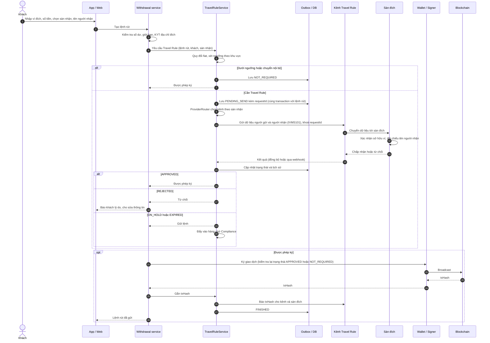
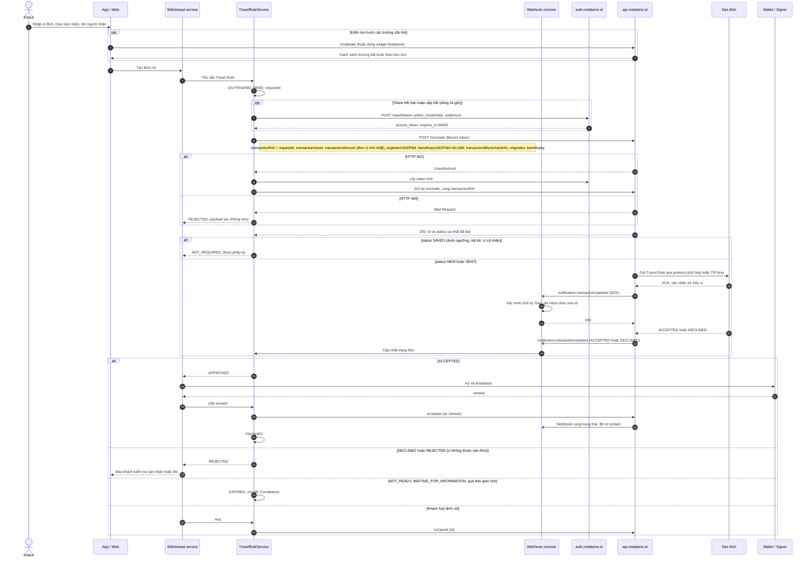
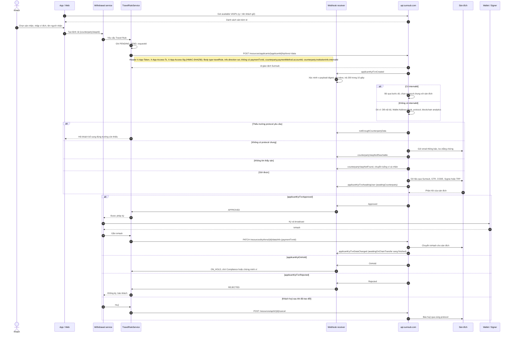
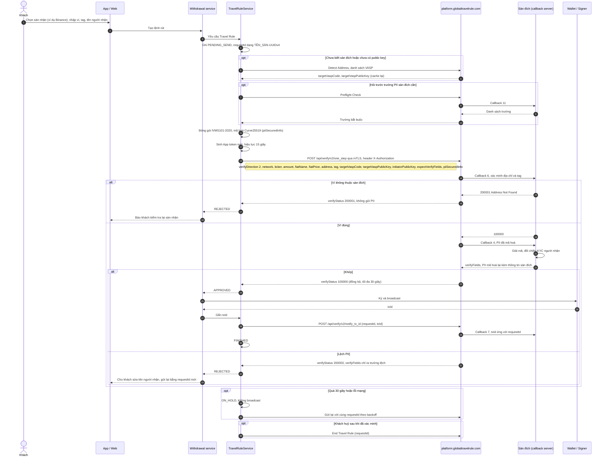
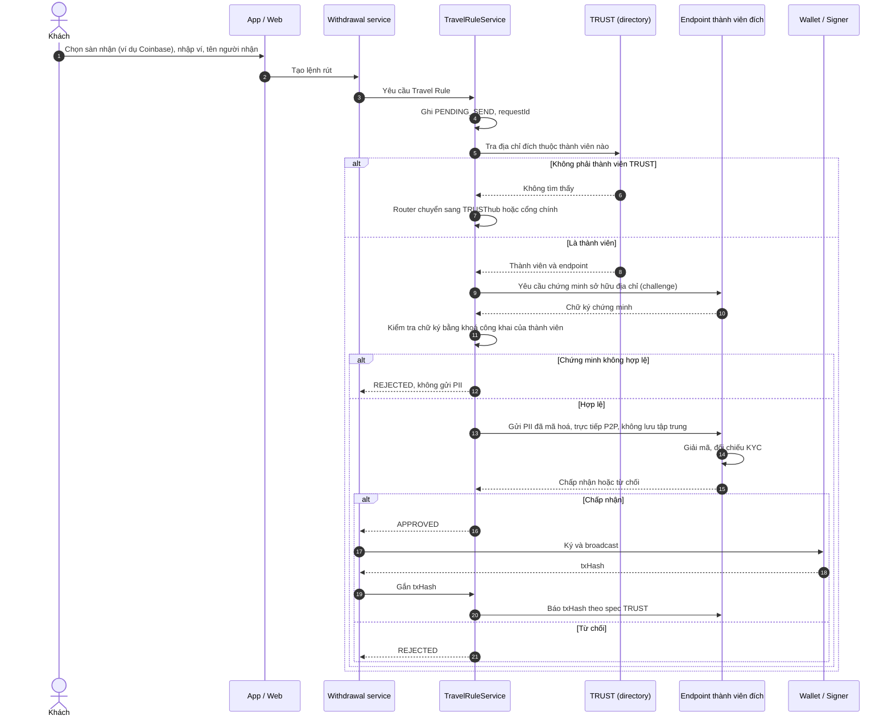
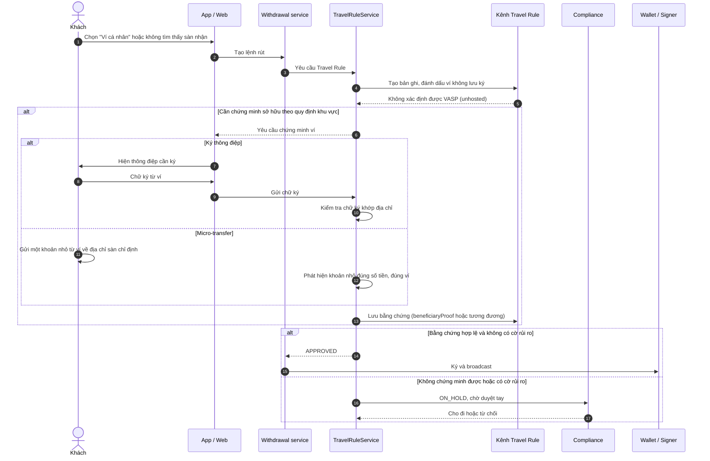
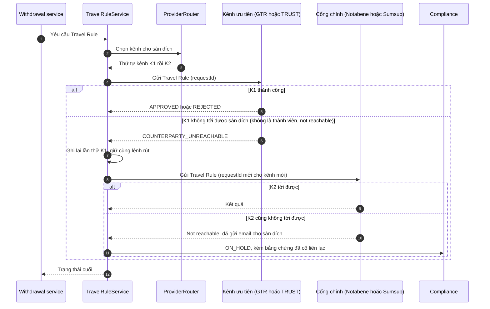
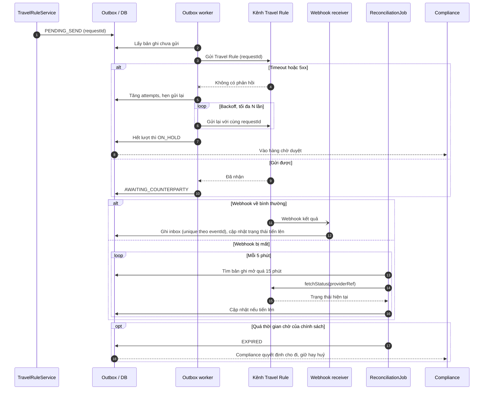
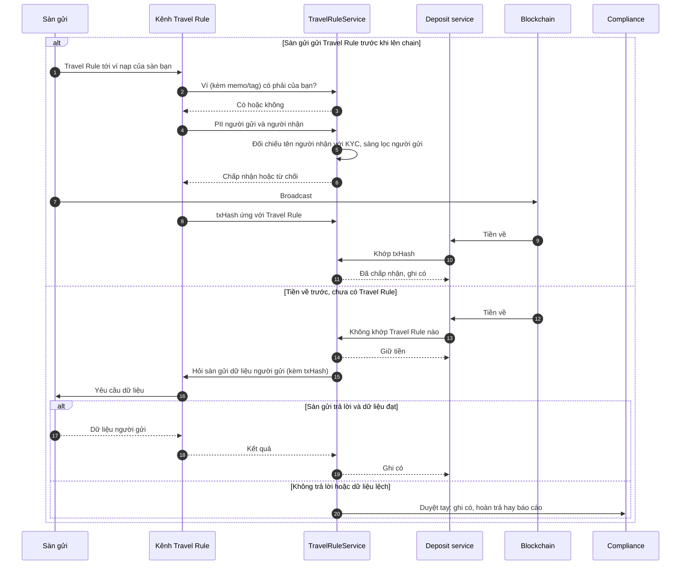

# Tích hợp Travel Rule cho luồng rút tiền ra sàn quốc tế

Nov 4, 2026 · @Mincuk

## Tổng quan

Khi khách rút tiền ra một sàn quốc tế, sàn của bạn là **sàn gửi** (originator VASP). Sàn phải trao đổi xong dữ liệu người gửi và người nhận với sàn đích **trước khi** ký và broadcast giao dịch on-chain. Tài liệu này mô tả luồng đó qua từng kênh (Notabene, Sumsub, GTR, TRUST) bằng sơ đồ sequence. Luồng chiều ngược (sàn khác rút về sàn của bạn) được mô tả ngắn ở phần cuối.

Trên sơ đồ, các thành phần phía sàn của bạn mang tên như sau:

| Tên trên sơ đồ | Vai trò |
| --- | --- |
| App / Web | Màn hình rút tiền: thu thập ví đích, sàn nhận, tên người nhận |
| Withdrawal service | Quản lý lệnh rút; chỉ ký và broadcast khi Travel Rule cho phép |
| TravelRuleService | Xét ngưỡng, chọn kênh, gọi bên thứ ba, giữ trạng thái |
| Outbox / DB | Ghi bản ghi trước khi gọi API, đảm bảo gọi lại được với cùng `requestId` |
| Webhook receiver | Nhận webhook của Notabene/Sumsub, xác minh chữ ký, ghi inbox, trả 200 ngay |
| Wallet / Signer | Ký giao dịch, broadcast lên blockchain |
| Compliance | Duyệt tay các trường hợp giữ lại, hết hạn, hoặc lệch dữ liệu |

### Chọn kênh theo sàn đích

Không có một mạng duy nhất tới được mọi sàn. `ProviderRouter` chọn kênh cho từng lệnh rút theo sàn đích:

| Sàn đích (ví dụ) | Kênh ưu tiên | Kênh dự phòng |
| --- | --- | --- |
| Binance, OKX, Bybit, Bitget, Gate, HashKey | GTR (nếu sàn của bạn là thành viên) | Sumsub (cầu nối GTR), rồi Notabene |
| Coinbase, Kraken, Gemini, Crypto.com, Robinhood | TRUST (nếu sàn của bạn là thành viên) | TRUSThub, rồi cổng chính |
| Các sàn còn lại | Cổng chính: Notabene hoặc Sumsub | Cổng còn lại, rồi email (Sumsub, GTR Out-of-Network) |
| Không xác định được sàn | Xử lý như ví cá nhân | Compliance duyệt tay |

Bảng trên là ví dụ dựa trên thành viên công bố của từng mạng. Danh sách thật nằm trong bảng `VaspDirectory` do đội compliance duy trì, cập nhật theo tỷ lệ phản hồi thực tế của từng sàn.

### Điều kiện trước khi mở luồng rút

- Khách đã KYC; có họ tên dạng Latin không dấu, ngày sinh, địa chỉ hoặc số giấy tờ, theo yêu cầu IVMS101 của khu vực pháp lý.
- Đã onboarding xong với cổng chính, và với GTR/TRUST nếu dùng.
- Đã chốt ngưỡng áp dụng theo khu vực pháp lý của sàn (FATF khuyến nghị 1.000 USD/EUR; EU áp dụng mọi giao dịch).
- Trên UI rút tiền có ô **chọn sàn nhận**. Sumsub ghi rõ đây là yếu tố lớn nhất quyết định tỷ lệ thành công, vì dò sàn chỉ từ địa chỉ ví thường thất bại.

## Luồng rút chung

Mọi kênh đều đi theo cùng một khung: **ghi DB → gửi dữ liệu → chờ kết quả → ký và broadcast → báo txHash**. Các kênh chỉ khác nhau ở bước "Gửi dữ liệu" và "Kết quả"; các phần sau triển khai chi tiết hai bước này cho từng kênh.

### Trạng thái của lệnh rút

| Trạng thái | Ý nghĩa | Được ký? |
| --- | --- | --- |
| `NOT_REQUIRED` | Dưới ngưỡng hoặc nội bộ; vẫn lưu vết | Có |
| `PENDING_SEND` | Đã ghi DB, chưa gọi kênh | Không |
| `AWAITING_COUNTERPARTY` | Đã gửi, chờ sàn đích | Không |
| `APPROVED` | Sàn đích chấp nhận hoặc rules cho đi | Có |
| `REJECTED` | Ví không thuộc sàn đích, tên lệch, hoặc bị từ chối | Không |
| `ON_HOLD` | Chờ compliance hoặc chứng minh ví cá nhân | Không |
| `EXPIRED` | Sàn đích không trả lời trong thời gian chờ | Chỉ khi compliance duyệt |
| `BROADCASTED` | Đã lên chain, chưa báo txHash | — |
| `FINISHED` | Đã báo txHash, đóng | — |
| `CANCELLED` | Khách huỷ, đã báo huỷ cho kênh | Không |

Kiểm tra "được ký" phải nằm ở **Wallet / Signer**, không chỉ ở Withdrawal service hay UI, để không đường nào bỏ qua được Travel Rule.

## Rút qua Notabene

Notabene là cổng trung gian: sàn gọi `tx/create` một lần, Notabene tự tìm sàn đích và chọn protocol. Kết quả về qua một loại webhook duy nhất. Chỉ broadcast khi trạng thái là `ACCEPTED` (hoặc `SAVED` khi không cần Travel Rule).

| Bước | API | Điểm cần lưu ý |
| --- | --- | --- |
| Lấy token | `POST https://auth.notabene.id/oauth/token` | `audience` = `https://api.notabene.dev` (sandbox) hoặc `https://api.notabene.id` (production). Cache token, làm mới khi hết hạn hoặc gặp 401 |
| Tạo Travel Rule | `POST https://api.notabene.id/tx/create` | `transactionRef` là khoá chống trùng. `transactionAmount` là chuỗi số nguyên theo đơn vị nhỏ nhất (satoshi, wei). Bỏ `beneficiaryVASPdid` thì Notabene tự dò; địa chỉ có nhiều chủ sẽ không dò được |
| Nhận kết quả | Webhook `notification.transactionUpdated` | Gửi qua Svix từ IP EU. Mỗi lần gửi toàn bộ bản ghi, nên xử lý bằng cách so trạng thái |
| Báo txHash | `txUpdate` | Giúp sàn đích khớp tiền về với Travel Rule; sinh thêm một webhook cùng trạng thái |
| Huỷ | `txCancel` | Gọi khi khách bỏ lệnh sau khi đã tạo Travel Rule |

Ngoài `tx/create`, tên và đường dẫn các API còn lại cần đối chiếu trong API reference của Notabene. Notabene không nối trực tiếp vào TRUST, nên lệnh rút tới thành viên TRUST nên đi kênh TRUST nếu sàn của bạn là thành viên.

## Rút qua Sumsub

Với Sumsub, lệnh rút là một giao dịch KYT `type: travelRule`, `direction: out`, gửi **trước khi** có txHash. Sumsub chọn protocol chung với sàn đích, hoặc gửi email nếu không có. Withdrawal service dựa vào **kết quả duyệt** (webhook `Approved` / `Rejected` / `OnHold`), còn trạng thái trao đổi dữ liệu lưu lại để báo cáo.

| Bước | API | Điểm cần lưu ý |
| --- | --- | --- |
| Danh sách sàn cho UI | Get available VASPs | Tìm theo tên thương hiệu qua `q`; chọn nhóm sàn thì Sumsub tự chọn pháp nhân phù hợp |
| Ký request | 3 header `X-App-*` | Chuỗi ký = timestamp + method + path + body; lệch giờ dưới 1 phút. Sandbox và production cùng host, phân biệt bằng token `sbx:` / `prod:` |
| Tạo giao dịch | `POST .../kyt/txns/-/data` (khách đã là applicant) | Khách chưa là applicant: dùng API "Submit transaction without applicant". Có `paymentTxnId` thì thành luồng sau khi lên chain |
| Trường tối thiểu theo protocol | `counterparty` | GTR và CODE cần `type` và tên (`fullName`, hoặc `firstNameEn` + `lastNameEn` + `nameType`); CODE cần thêm `dob` của khách |
| Nhận kết quả | Webhook | Xác minh `x-payload-digest` theo thuật toán trong `X-Payload-Digest-Alg` (nên dùng `HMAC_SHA256_HEX`). Trả 401/403/404 thì Sumsub không gửi lại |
| Báo txHash | `PATCH /resources/kyt/txns/{id}/data/info` | Bước duy nhất đưa giao dịch về `finished`; hay bị bỏ sót nhất |
| Huỷ | `POST /resources/api/tr/{id}/cancel` | Không huỷ thì chiếm hàng chờ của sàn đích và bị ghi nhận là không phản hồi |

Có thể thay bước 1–5 bằng **Travel Rule SDK** của Sumsub: SDK tự hỏi khách chọn sàn, thu đủ trường protocol cần, xử lý ví cá nhân và tạo giao dịch. Mức hỗ trợ cầu nối sang GTR (giao dữ liệu đầy đủ hay chỉ xác thực) cần Sumsub xác nhận trước khi dựa vào Sumsub cho lệnh rút tới Binance.

## Rút qua GTR

GTR là kênh trực tiếp tới Binance và các thành viên GTR. Toàn bộ xác minh chạy **đồng bộ** trong một lời gọi `one_step` (tối đa 30 giây): GTR hỏi sàn đích địa chỉ có thuộc họ không, đúng thì mới chuyển PII. Sàn của bạn phải tự chỉ định sàn đích (`targetVaspCode`) và tự mã hoá PII bằng Curve25519.

| Bước | API | Điểm cần lưu ý |
| --- | --- | --- |
| Kết nối | mTLS bằng `certificate.p12` | UAT: `uat-platform.globaltravelrule.com`. Production: `platform.globaltravelrule.com`, khoá và chứng chỉ riêng, không dùng lại khoá UAT |
| Xác thực | Header `X-Authorization` (App token) | `vaspSecretKeyHash` = SHA-512(`secretKey` + `vaspCode`); `secretToken` = SHA-512 của `accessKey`, `vaspSecretKeyHash`, `nonce`, `timestamp`, `expires`, `verifyType` nối bằng `\|`; token = Base64 của JSON các trường này |
| Tìm sàn đích | Detect Address, danh sách VASP | Cache `targetVaspCode` và public key; làm mới khi giải mã lỗi |
| Mã hoá PII | Thư viện `encryption-tools` của GTR | `piiSecretFormatType` = `FULL_JSON_OBJECT_ENCRYPT`, `piiSpecVersion` = `ivms101-2020`. Không tự cài đặt mật mã |
| Gửi Travel Rule | `POST /api/verify/v2/one_step` | Luôn trả HTTP 200, kết quả ở `verifyStatus`: `100000` thành công, `200001` sai ví, `200003` lệch PII. `fiatPrice` chốt tại thời điểm gửi |
| Báo txId | `POST /api/verify/v2/notify_tx_id` | Bắt buộc sau broadcast để sàn đích khớp tiền về |
| Huỷ | End Travel Rule | Đóng phiên khi khách bỏ lệnh |

Nếu sàn đích không có trong GTR, dùng Out-of-Network API (email bảo mật kèm link xem PII) hoặc để router chuyển sang cổng chính. Gói Trial chỉ 100 request/ngày, chỉ đủ cho UAT.

## Rút qua TRUST

TRUST là kênh trực tiếp tới Coinbase, Kraken, Gemini, Crypto.com và các thành viên khác, nhưng chỉ dùng được khi sàn của bạn cũng là thành viên. TRUST không công bố spec API; sơ đồ dưới đây là luồng nguyên lý dựa trên mô tả công khai: **chứng minh sở hữu địa chỉ trước, rồi mới gửi PII trực tiếp giữa hai sàn**. Tên thông điệp thật lấy theo spec cấp cho thành viên.

| Hạng mục | Nội dung |
| --- | --- |
| Điều kiện | Là thành viên TRUST sau thẩm định AML, bảo mật, quyền riêng tư; VASP nhỏ có thể xin gói miễn phí |
| Điểm khác biệt | Bắt buộc chứng minh sở hữu địa chỉ bằng mật mã trước khi gửi PII; không có nơi lưu dữ liệu trung gian |
| Sàn đích ngoài mạng | TRUSThub (ra mắt 05/2026), hoặc router chuyển sang cổng chính |
| Đường tắt | 21 Analytics có kết nối TRUST sẵn; sàn vẫn phải tự xin thành viên |
| Rủi ro | Theo Notabene, nhiều thành viên chưa chạy TRUST thật; đo tỷ lệ phản hồi theo từng sàn và hạ ưu tiên nếu thấp |

## Trường hợp đặc biệt

Ba tình huống dưới đây xảy ra với mọi kênh và nên xử lý một lần trong `TravelRuleService`. Nguyên tắc chung: khi không chắc chắn thì không ký, đưa vào hàng chờ compliance.

### Rút về ví cá nhân hoặc không xác định được sàn

Không có sàn đích để trao đổi dữ liệu, nên sàn phải tự lưu thông tin người nhận và, tùy khu vực pháp lý, yêu cầu khách chứng minh sở hữu ví. EU yêu cầu xác minh với giao dịch trên 1.000 EUR tới ví tự quản.

Ở Notabene, bằng chứng đi qua `beneficiaryProof` (chữ ký mật mã, ảnh chụp, tự khai, hoặc micro-transfer). Ở Sumsub, luồng Unhosted wallet verification tự kích hoạt khi trạng thái là `counterpartyVaspNotFound`. Ở GTR, dùng Wallet Verify API.

### Kênh ưu tiên không tới được sàn đích

Router thử kênh kế tiếp thay vì từ chối ngay. Mỗi lần thử được ghi lại để làm bằng chứng đã cố liên lạc với sàn đích.

`REJECTED` (sàn đích đã trả lời "không") **không** được chuyển sang kênh khác để thử lại. Chỉ chuyển kênh khi kênh trước không tới được sàn đích.

### Timeout, lỗi mạng và webhook bị mất

Các con số 5 phút, 15 phút và N lần là gợi ý ban đầu; điều chỉnh theo SLA của sàn. Với GTR, `one_step` là đồng bộ nên không có webhook kết quả; trường hợp timeout thì gửi lại với cùng `requestId` hoặc tra Travel Rule History trước khi tạo yêu cầu mới.

## Bổ sung: luồng rút từ sàn khác về sàn của bạn

Khi khách rút từ sàn khác về, sàn của bạn là **sàn nhận** (beneficiary VASP). Việc của sàn là: xác nhận ví thuộc mình, đối chiếu tên người nhận với KYC, rồi chỉ ghi có khi khoản tiền khớp với một Travel Rule đã chấp nhận. Có hai trường hợp: sàn gửi gửi dữ liệu trước, hoặc tiền về trước khi có dữ liệu.

Mỗi kênh hiện thực các bước trên theo cách riêng:

| Kênh | Xác nhận ví và nhận PII | Khi tiền về | Tiền về trước, chưa có dữ liệu |
| --- | --- | --- | --- |
| Notabene | Address webhook (hoặc `txConfirm`), rồi `txAccept` / `txDecline` hoặc rules engine | Gọi `txNotify` cho **mọi** khoản nạp, backoff tới khoảng 1 giờ | `txNotify` trả `INCOMPLETE`: hỏi khách thông tin người gửi, `txUpdate` |
| Sumsub | Giao dịch mirrored + webhook `applicantKytTxnCreated`; xác nhận sở hữu, bổ sung người nhận | Khớp txHash với giao dịch đã duyệt | Tạo giao dịch `direction: in` có `paymentTxnId`; chờ `completed` hoặc bị từ chối |
| GTR | Callback 6 (địa chỉ), callback 4 (PII) — trả lời **đồng bộ** | Callback 7 cho ánh xạ txId với requestId | Gọi `one_step` với `verifyDirection = 1` và `txId` |
| TRUST | Endpoint của sàn ký chứng minh ví, rồi nhận PII P2P | Khớp theo thông báo txHash của sàn gửi | Theo spec TRUST cấp cho thành viên |

Hai điểm dễ sai ở chiều nhận:

- **Xác định khách bằng địa chỉ và memo/tag của giao dịch**, không dùng địa chỉ nằm trong PII. GTR nói rõ điều này cho callback 4.
- **Endpoint nhận phải luôn sẵn sàng và nhanh.** GTR chờ phản hồi đồng bộ; Sumsub chỉ đợi 10 giây; endpoint TRUST ngừng là mọi khoản nạp từ thành viên TRUST bị kẹt. Tra ví và KYC từ cache, giám sát ngang với API nạp tiền.

## Nguồn

Notabene: [Generate accessToken](https://devx.notabene.id/v1.0/docs/auth0) · [Create transfer](https://devx.notabene.id/reference/txcreate-1) · [Travel Rule statuses](https://devx.notabene.id/docs/tr-status_vnext) · [System interactions](https://devx.notabene.id/docs/how-does-our-apis-interact-with-your-system) · [txNotify](https://devx.notabene.id/v1.0/docs/calling-txnotify-for-every-deposit) · [Notification webhook](https://devx.notabene.id/v1.0/docs/updating)

Sumsub: [Quickstart](https://docs.sumsub.com/docs/travel-rule-quickstart-guide) · [Authentication](https://docs.sumsub.com/reference/authentication) · [Start exchange before settlement](https://docs.sumsub.com/docs/start-exchange-before-settlement) · [After on-chain incoming transfer](https://docs.sumsub.com/docs/after-on-chain-incoming-transfer) · [Transaction scenarios](https://docs.sumsub.com/docs/transaction-scenarios) · [Webhook manager](https://docs.sumsub.com/docs/webhook-manager) · [GTR protocol](https://docs.sumsub.com/docs/gtr-protocol)

GTR: [Before Integration](https://www.globaltravelrule.com/documentation/before-integration) · [Authentication](https://www.globaltravelrule.com/documentation/authentication) · [Submit One Step Travel Rule](https://www.globaltravelrule.com/documentation/api-references/gtr-2-0-sync-api/post-api-verify-v-2-one-step) · [Address Existence Verify Callback](https://www.globaltravelrule.com/documentation/callback-api-references/callback-api/post-address-exists-verify-6) · [PII Verification Callback](https://www.globaltravelrule.com/documentation/callback-api-references/callback-api/post-pii-verify-4) · [TXID Notify Callback](https://www.globaltravelrule.com/documentation/standard2-api/callback-api-5-update-tx-id) · [Subscription](https://www.globaltravelrule.com/documentation/subscription)

TRUST: [Coinbase – TRUST](https://www.coinbase.com/travelrule) · [Expanding TRUST (05/2026)](https://www.coinbase.com/blog/expanding-trust-a-privacy-first-network-for-global-crypto-compliance) · [Notabene – phân tích TRUST](https://notabene.id/travel-rule-messaging-protocols/ustrwg) · [21 Analytics – TRUST](https://www.21analytics.co/coinbase-trust/)

Tài liệu liên quan: [Tích hợp Travel Rule vào sàn CEX (Java)](https://claude.ai/artifact/3uP1UaZVoFMsm8pgrkGqmi), có code Java mẫu và danh mục sự cố đầy đủ.
